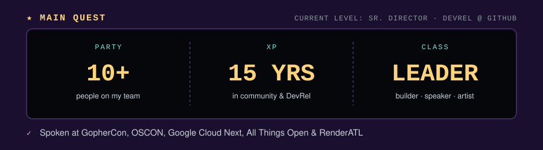
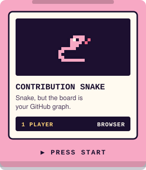
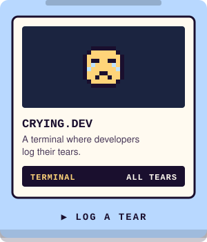
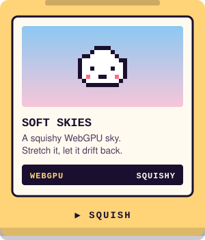

<a href="https://yetanothersnake.dev"><picture><source media="(max-width: 600px) and (prefers-color-scheme:light)" srcset="assets/phone/header-light.svg"><source media="(max-width: 600px)" srcset="assets/phone/header.svg"><source media="(prefers-color-scheme: light)" srcset="assets/header-light.svg"></picture></a> 
<picture><source media="(max-width: 600px) and (prefers-color-scheme:light)" srcset="assets/phone/mainquest-light.svg"><source media="(max-width: 600px)" srcset="assets/phone/mainquest.svg"><source media="(prefers-color-scheme: light)" srcset="assets/mainquest-light.svg"></picture> 
<picture><source media="(max-width: 600px) and (prefers-color-scheme:light)" srcset="assets/phone/sidequests-light.svg"><source media="(max-width: 600px)" srcset="assets/phone/sidequests.svg"><source media="(prefers-color-scheme: light)" srcset="assets/sidequests-light.svg"></picture> 
<a href="https://yetanothersnake.dev"><picture><source media="(max-width: 600px) and (prefers-color-scheme:light)" srcset="assets/phone/cart-1-light.svg"><source media="(max-width: 600px)" srcset="assets/phone/cart-1.svg"><source media="(prefers-color-scheme: light)" srcset="assets/cart-1-light.svg"></picture></a><a href="https://crying.dev"><picture><source media="(max-width: 600px) and (prefers-color-scheme:light)" srcset="assets/phone/cart-2-light.svg"><source media="(max-width: 600px)" srcset="assets/phone/cart-2.svg"><source media="(prefers-color-scheme: light)" srcset="assets/cart-2-light.svg"></picture></a><a href="https://soft-skies.netlify.app"><picture><source media="(max-width: 600px) and (prefers-color-scheme:light)" srcset="assets/phone/cart-3-light.svg"><source media="(max-width: 600px)" srcset="assets/phone/cart-3.svg"><source media="(prefers-color-scheme: light)" srcset="assets/cart-3-light.svg"></picture></a> 
<picture><source media="(max-width: 600px) and (prefers-color-scheme:light)" srcset="assets/phone/credits-light.svg"><source media="(max-width: 600px)" srcset="assets/phone/credits.svg"><source media="(prefers-color-scheme: light)" srcset="assets/credits-light.svg"></picture>

